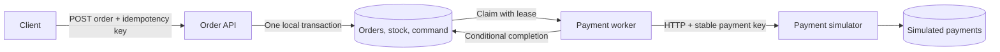

# Architecture and recovery

OrderFlow has two application processes and two databases. The order service owns products, orders, order lines and payment commands. The payment simulator owns payment outcomes and idempotency records. The applications communicate through an HTTP API, so either application can fail between its database commit and the other application's next step.

## Order acceptance

The client provides product identifiers and quantities, never authoritative prices. The service reads prices from its catalogue and computes totals in integer minor units. Stock is reserved atomically with the order and its payment command. A failed reservation rolls the entire acceptance transaction back.

The order idempotency key is unique. A matching request fingerprint returns the existing order; a different fingerprint under the same key returns a conflict. This separates a client's retry from an additional purchase. A unique database constraint protects concurrent requests as well as sequential ones.

## Durable command delivery

The `payment_command` row is a command outbox: order acceptance commits both the business state and the intent to request payment. Commands move through `READY`, `PROCESSING`, and either `DONE` or `DEAD`. The worker claims due commands using a lease. Network calls occur outside the database transaction, avoiding a database lock held across a remote call.

Completion must match the current lease token. If an old worker returns after its lease expires and another worker has reclaimed the command, the stale response cannot overwrite the newer command state.

There is no atomic commit across an HTTP call and both databases. Delivery therefore permits duplicates. The simulator's idempotency record makes repeated requests resolve to one payment identity and one simulated capture. A command retry reuses the same payment identity, including an explicit retry from review.

## Failure behavior

| Failure point or outcome | Recovery |
|---|---|
| Order acceptance fails before commit | Order, stock change and payment command roll back together |
| Worker stops before sending | Persisted command remains available after its lease expires |
| Payment persists, response is lost | Worker retries; payment API returns the original payment identity |
| Worker stops after receiving success but before recording it | Command can be delivered again after lease expiry; idempotency protects the payment |
| Provider definitely declines | Order reaches a declined state and reserved stock is restored once |
| Attempts are exhausted with an uncertain result | Order enters `PAYMENT_REVIEW`; stock remains reserved |
| Operator retries an order in review | Another bounded attempt cycle begins with the same payment identity |

A timeout or server error does not prove that no payment happened. Releasing stock immediately in that situation could let another order consume it while the first payment has already succeeded. Holding the reservation in review makes that unresolved state explicit.

The simulator's `LOST_RESPONSE` scenario models this by committing a capture before returning HTTP `503`. It is a deterministic illustration of an ambiguous result, rather than a real network fault injector. `captureCount` is a persisted simulation counter; it does not represent an actual charge.

## Consistency and scope

- Each database uses local transactions. Cross-service state becomes consistent as commands complete.
- Delivery is at least once. The project does not claim exactly-once transport.
- H2 file databases preserve local runs across application restarts. Run one instance of each application against its own file database.
- Default file-database URLs set `WRITE_DELAY=0` to remove H2's deferred commit flushing. Keep this setting when overriding an H2 file URL. The packaged smoke test abruptly stops and restarts application processes to check acknowledged records and queued commands; it does not simulate an operating-system crash or a power failure. See [H2's durability notes](https://h2database.github.io/html/advanced.html#durability_problems).
- The current workflow ends at payment confirmation or decline; it has no fulfilment or refund lifecycle.
- Payment scenarios are demo inputs. A real checkout would select an actual provider integration and obtain its outcome from provider responses, not from a client-selected scenario.
- The API keys protect local service routes. Customer identity, authorization by order owner, secret rotation and an internet-facing deployment are separate work.

## Code map

Begin with the `orders` package in `order-service`: follow order acceptance into database writes, then follow command claiming and payment processing into completion. `Models` defines the API and worker records; `OrderProperties` validates timeouts, attempts, leases and the configured payment origin.

`OrderController` exposes the REST operations, `OrderService` owns transactions and state changes, `PaymentDispatcher` drives scheduled work, `PaymentClient` validates provider responses, and `GatewayTransport` bounds HTTP response size and duration. Read those classes in that order when tracing a request.

In `payment-simulator`, read `PaymentController`, then `PaymentService`. Notice that a simulated unavailable response is returned only after the transaction decision has been committed, which is essential for demonstrating the lost-response case. `PaymentView` exposes `requestAttempts` and `captureCount` for the demo.

Each module's `schema.sql` shows ownership boundaries, unique constraints and indexes. Test files exercise the failure paths alongside the happy path. The Maven `verify` phase writes the measured coverage reports; their values should be read from the current build rather than treated as fixed project claims.
